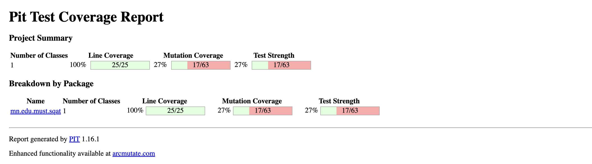
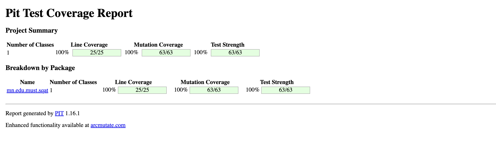

# Лаборатори №11: Mutation testing — PIT

**Овог нэр:** Ч.Оюумаа 

**Оюутны код:** B232270133 

## Орчин

```
$ java -version
openjdk version "17.0.21.1" 2026-11-17
OpenJDK Runtime Environment Homebrew (build 17.0.21.1+0)
OpenJDK 64-Bit Server VM Homebrew (build 17.0.21.1+0, mixed mode, sharing)

$ mvn -version
Apache Maven 3.10.2 (61b8bc355f4c4325463c22aa9afe4e7811a290f8)
Maven home: /opt/homebrew/Cellar/maven/3.10.2/libexec
Java version: 17.0.21.1, vendor: Homebrew, runtime: /opt/homebrew/Cellar/openjdk@17/17.0.21.1/libexec/openjdk.jdk/Contents/Home
Default locale: en_MN, platform encoding: UTF-8, time zone: Asia/Ulaanbaatar
OS name: "mac os x", version: "26.1", arch: "aarch64", family: "mac"
```

(Бүтэн гаралт: `results/versions.txt`)

---

## 1. Эхний хэмжилт

### JaCoCo


Line 100% (25/25), Branch 38/41 — `results/jacoco-start.csv`, `results/mvn-verify-start.txt`.

### PIT



`results/pit-start.txt`-ээс:

```
>> Line Coverage (for mutated classes only): 25/25 (100%)
>> Generated 63 mutations Killed 17 (27%)
>> Mutations with no coverage 0. Test strength 27%
```

### Ажиглалт

JaCoCo кодын мөр бүрийг (25/25) ажилласан гэж харуулж байгаа ч PIT-ийн 63 мутантаас тестүүд ердөө 17-г (27%) л барьсан. Энэ нь тестүүд код бүрийг ажиллуулдаг боловч буцаасан утгыг нарийн шалгадаггүй (`assertNotNull`, `assertTrue(0 <= x <= 100)`) тул кодыг буруу болгосон ч тест унахгүй гэсэн үг. Өөрөөр хэлбэл хамралт нь кодыг "ажиллуулсан" эсэхийг, mutation score нь алдааг "илрүүлж чадах" эсэхийг хэмждэг.

---

## A. Амьд мутантуудын ангилал

Starter дээр 63-аас 46 мутант амьд үлдсэн. Бүгдийг нь доор ангилав (ижил шалтгаантайг нэгтгэсэн, хаалтанд тоо):

| Мөр | Мутаци (PIT-ийн тайлбар) | Ангилал | Үндэслэл | Арга хэмжээ |
|---|---|---|---|---|
| 20 | changed conditional boundary: `< 0 → <= 0`, `> 100 → >= 100` (2) | Тест дутуу | 0 ба 100 зөв оролт боловч мутант exception шиддэг тул зан төлөв өөрчлөгдөнө. | `letterGrade(0)="F"`, `letterGrade(100)="A"` тест |
| 23–26 | changed conditional boundary: `>= → >` (4) | Тест дутуу | Яг 90/80/70/60 оноонд нэг доод үсэг буцаадаг тул зан төлөв өөрчлөгдөнө. | 90/89.99, 80/79.99, 70/69.99, 60/59.99 зааг тест |
| 23–26 | removed conditional – replaced comparison check with true / false (8) | Тест дутуу | Өөр үсэг буцаадаг ч `assertNotNull` үүнийг шалгадаггүй. | `assertEquals("A", …)` гэх мэт яг утга |
| 23–27 | replaced return value with "" (5) | Тест дутуу | `""` нь null биш тул `assertNotNull` өнгөрч, gpa-д 0 нэмэгдэн 0–4 мужид үлддэг. | Яг үсгийг `assertEquals`-аар шалгах |
| 36 | switch мутаци (SwitchMutator) (1) | Тест дутуу | A ба F-ийн оноо солигдох ч голч 0–4 мужид үлддэг тул тест барьдаггүй. | Үсэг тус бүрээр `gpa` яг утгын тест |
| 38, 40 | Replaced double addition with subtraction (2) | Тест дутуу | B, D-ийн оноо хасагдсан ч голч 0–4 мужид үлддэг. | `assertEquals(3.5, gpa(95, 85))` |
| 44 | replaced double return with 0.0d (1) | Тест дутуу | 0.0 нь 0–4 мужид багтдаг тул муж шалгах тест барьдаггүй. | Голчийн яг утга |
| 48 | changed conditional boundary: `gpa < 0 → <= 0`, `credits < 0 → <= 0` (2) | Тест дутуу | gpa=0, credits=0 зөв оролт боловч мутант exception шиддэг. | `scholarship(0.0, 10)`, `scholarship(3.5, 0)` |
| 48 | removed conditional – replaced comparison check with false (`gpa < 0`) (1) | Тест дутуу | Сөрөг голчийг шалгахаа больдог; сөрөг оролтын тест байхгүй. | `scholarship(-0.1, …)` → exception |
| 51 | removed conditional – replaced equality check with true / false (2) | Тест дутуу | Зөрчилтэй/зөрчилгүйг ялгахаа больдог ч үр дүн 0–100 мужид үлддэг. | Зөрчилтэй ба зөрчилгүй яг утгын тест |
| 52–54 | changed conditional boundary: `>= → >` (5) | Тест дутуу | 3.8/15, 3.4/12, 3.0 заагт өөр хувь буцаадаг. | Зааг бүрт яг утгын тест |
| 52–54 | removed conditional – replaced comparison check with true / false (10) | Тест дутуу | Нөхцөлийн нэг хэсгийг үл тоодог тул өөр хувь буцаадаг ч мужид үлддэг. | Заагийн доод/дээд талын тест |
| 52–54 | replaced int return with 0 (3) | Тест дутуу | 0 нь 0–100 мужид багтдаг тул муж шалгах тест барьдаггүй. | `assertEquals(100/70/50, …)` |

**Нийт: 46 амьд мутант, бүгд "тест дутуу", equivalent — 0.** Ихэнх нь сул assertion-аас (B1), үлдсэн нь зааг тест дутуугаас (B2) шалтгаалсан.

---

## B. Тестүүдийг хүчтэй болгох

| Хэмжилт | Өөрчлөлт | Killed / Generated | Mutation Coverage | Test strength | Файл |
|---|---|---|---|---|---|
| Эхлэл | starter-ийн сул тест | 17 / 63 | 27% | 27% | `results/pit-start.txt` |
| B1 | assertion-ууд яг утгын | 45 / 63 | 71% | 71% | `results/pit-B1.txt` |
| B2 | + зааг утгын тестүүд | 63 / 63 | 100% | 100% | `results/pit-B2.txt` |

- **B1:** `assertNotNull`, `assertTrue(муж)`-ийг оролтыг нь өөрчлөхгүйгээр `assertEquals`-аар солив. B1-ийн дараа 18 мутант амьд үлдсэн: 13 нь changed conditional boundary, 5 нь removed conditional (replaced comparison check with true) — бүгд зааг утгын тест дутуугаас үүдэлтэй.
- **B2:** letterGrade-ийн 90/89.99, 80/79.99, 70/69.99, 60/59.99, 0, 100; scholarship-ийн 3.8/15, 3.4/12, 3.0 заагууд, gpa 0 ба 4, credits 0, сөрөг оролт; gpa-гийн бүх үсгэн дүн тус бүрээр.

Эцсийн PIT тайлан:



---

## C. Гараар хийсэн мутаци

_[`gpa >= 3.8` → `gpa > 3.8` болгоод `mvn test` ажиллуулсан үр дүн: унасан тестийн нэр, алдааны мөр — `results/mvn-test-manual-mutant.txt`-ээс хуулна. Дараа нь `git restore src/main`-ээр буцаасан.]_

### Өөрийн equivalent мутант

_[Жишээ: 26-р мөрийг `score >= 60 && score <= 100` болгох. 20-р мөр 100-аас их оноонд аль хэдийн exception шиддэг тул нэмэлт нөхцөл хэзээ ч худал болохгүй, үр дүн өөрчлөгдөхгүй. Тиймээс ямар ч тест эх код ба мутантыг ялгаж чадахгүй — бүх тест өнгөрнө.]_

---

## Дүгнэлт

_[6–8 өгүүлбэр: хамралт ба mutation score-ийн ялгаа; AI-гаар бичүүлсэн тестийг яагаад mutation score-оор шалгах хэрэгтэй.]_
## C. Гараар хийсэн мутаци

`scholarship()`-ийн 52-р мөрийн `gpa >= 3.8` нөхцөлийг `gpa > 3.8` болгож гараар өөрчлөөд `mvn test` ажиллуулсан (`results/mvn-test-manual-mutant.txt`):

~~~
[ERROR] Tests run: 18, Failures: 1, Errors: 0, Skipped: 0
[ERROR]   ScholarshipCalculatorTest.scholarship_boundary_100:119 expected: <100> but was: <70>
[ERROR] BUILD FAILURE
~~~

`scholarship_boundary_100` тест унасан: голч яг 3.8, кредит 15 үед 100% тэтгэлэг хүлээсэн боловч мутант 70% буцаасан. Энэ нь B2-д нэмсэн зааг утгын тест энэ мутантыг барьж байгааг баталж байна. Дараа нь `git restore src/main`-ээр кодыг буцаасан — мутацитай код commit хийгдээгүй.

### Өөрийн equivalent мутант

26-р мөрийн `if (score >= 60) return "D";`-г `if (score >= 60 && score <= 100) return "D";` болгох. 20-р мөр 100-аас их оноонд аль хэдийн exception шиддэг тул энэ мөрөнд хүрэх үед `score <= 100` үргэлж үнэн бөгөөд нэмэлт нөхцөл үр дүнг хэзээ ч өөрчлөхгүй. Ямар ч оролтод эх код ба мутант ижил гаралт өгдөг тул ямар ч тест тэдгээрийг ялгаж чадахгүй — бүх тест өнгөрнө.

---

## Дүгнэлт

Line coverage нь тестийн явцад кодын мөр ажилласан эсэхийг л хэмждэг бол mutation score нь кодыг буруу болгоход тест үүнийг илрүүлж чадах эсэхийг хэмждэг. Энэ лабын starter багц Line 100% (25/25) байсан ч 63 мутантаас ердөө 17-г (27%) л барьсан нь хамралт өндөр боловч тест сул байж болохыг харуулсан. B1-д оролтыг өөрчлөхгүйгээр зөвхөн assertion-уудыг яг утгын болгоход score 71% (45/63) болсон нь сул assertion гол асуудал байсныг харуулсан. B2-д зааг утгын тест нэмснээр үлдсэн 18 мутант бүгд алагдаж 63/63 (100%) болсон бөгөөд equivalent мутант нэг ч үлдээгүй. Энэ бүх явцад хамралт 100% хэвээр байсан тул сайжруулалтыг JaCoCo огт харуулаагүй — зөвхөн mutation testing илрүүлсэн. AI-гаар бичүүлсэн тестүүд кодыг бүхэлд нь ажиллуулж хамралт өндөр харагдуулдаг ч assertion нь сул, зааг утгыг алгасах хандлагатай байдаг. Тиймээс AI-ийн тестийг хамралтаар бус mutation score-оор шалгаж, амьд үлдсэн мутант бүрийг шинжилж тест нэмэх нь тестийн бодит чанарыг баталгаажуулах найдвартай арга юм.
