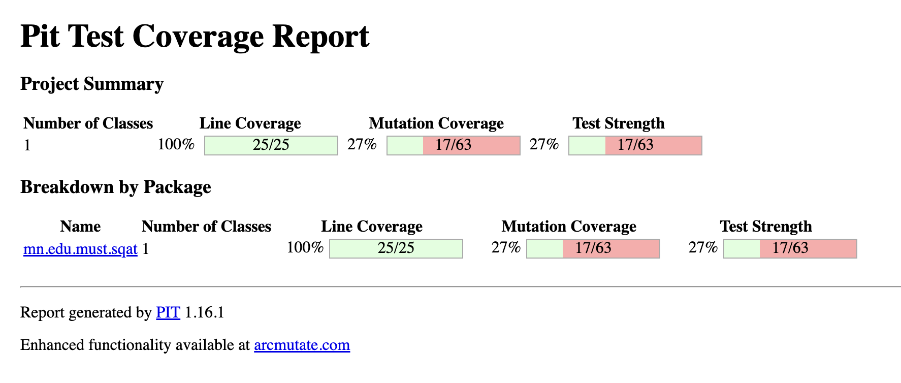

# Лаборатори №11: Mutation testing — PIT

**Овог нэр:** Ч.Оюумаа
**Оюутны код:** B232270133
F.CSA313 — Программ хангамжийн чанарын баталгаа ба тест (2026)

## Орчин

```
$ java -version
openjdk version "17.0.21.1" 2026-11-17
OpenJDK Runtime Environment Homebrew (build 17.0.21.1+0)
OpenJDK 64-Bit Server VM Homebrew (build 17.0.21.1+0, mixed mode, sharing)

$ mvn -version
Apache Maven 3.10.2 (61b8bc355f4c4325463c22aa9afe4e7811a290f8)
Maven home: /opt/homebrew/Cellar/maven/3.10.2/libexec
Java version: 17.0.21.1, vendor: Homebrew, runtime: /opt/homebrew/Cellar/openjdk@17/17.0.21.1/libexec/openjdk.jdk/Contents/Home
Default locale: en_MN, platform encoding: UTF-8, time zone: Asia/Ulaanbaatar
OS name: "mac os x", version: "26.1", arch: "aarch64", family: "mac"
```

(Бүтэн гаралт: `results/versions.txt`)

---

## 1. Эхний хэмжилт

### JaCoCo



Line 100% (25/25), Branch 38/41 — `results/jacoco-start.csv`, `results/mvn-verify-start.txt`.

### PIT


`results/pit-start.txt`-ээс:

```
>> Line Coverage (for mutated classes only): 25/25 (100%)
>> Generated 63 mutations Killed 17 (27%)
>> Mutations with no coverage 0. Test strength 27%
```

### Ажиглалт

JaCoCo кодын мөр бүрийг (25/25) ажилласан гэж харуулж байгаа ч PIT-ийн 63 мутантаас тестүүд ердөө 17-г (27%) л барьсан. Энэ нь тестүүд код бүрийг ажиллуулдаг боловч буцаасан утгыг нарийн шалгадаггүй (`assertNotNull`, `assertTrue(0 <= x <= 100)`) тул кодыг буруу болгосон ч тест унахгүй гэсэн үг. Өөрөөр хэлбэл хамралт нь кодыг "ажиллуулсан" эсэхийг, mutation score нь алдааг "илрүүлж чадах" эсэхийг хэмждэг.

---
